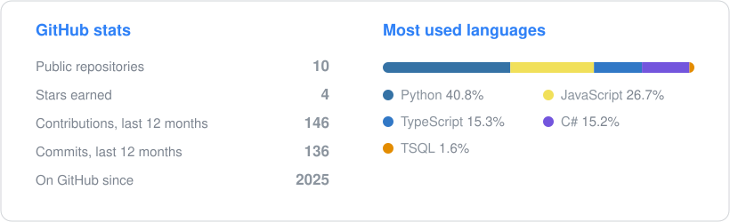

<h1 align="center">Hi, I'm Khang 👋</h1>

  <b>Data Engineer / Data Analyst</b> · IT student at HCMC University of Industry and Trade (HUIT) · Ho Chi Minh City, Vietnam 
  I build pipelines that collect, clean and model data on their own, and dashboards that answer a real question.

  
  
  

  

---

## Languages and tools

**Languages** 
    

**Data** 
      

**Engineering** 
   

---

## Data engineering

### 🗺️ [VN Tourism Pipeline](https://github.com/dtkhang05/vn-tourism-pipeline)
A near-real-time pipeline that ranks the tourist spots people in Vietnam are most interested in, from four independent sources. It refreshes itself every day with no machine left on. **[Live dashboard](https://vn-hot-travel.streamlit.app/)**
Python · Postgres · dbt · Airflow · GitHub Actions · Docker · Streamlit

### 📡 [GH AI Radar](https://github.com/dtkhang05/gh-ai-radar)
A pipeline over GH Archive (every public GitHub event, one file an hour): ingestion, data-quality checks, dbt models on DuckDB and an analysis of the open-source AI ecosystem.
Python · DuckDB · dbt · data quality testing

## Data analysis

| Project | What it shows | Tools |
|---|---|---|
| [Online Retail Customer Segmentation](https://github.com/dtkhang05/Online-Retail-Customer-Segmentation-RFM-Analysis) | RFM segmentation of 4,372 customers into 5 groups, with the revenue share of each | Power BI |
| [Student Academic Analytics](https://github.com/dtkhang05/PowerBI-Student-Academic-Analytics) | Performance and teaching quality for a cohort of 457 students | Power BI |

## A passion project: [Heartgift](https://github.com/dtkhang05/heartgift-showcase)

Animated 3D greeting cards in the browser, live at **[heartgift.app](https://heartgift.app)**. Built and run on my own: the scenes and music, accounts, payments and photo moderation, and on the data side Postgres with row-level security, an idempotent payment webhook and an anonymous conversion funnel.

---

## On GitHub

**Achievements:** 

The stats card is redrawn every day by a GitHub Action in this repository.
